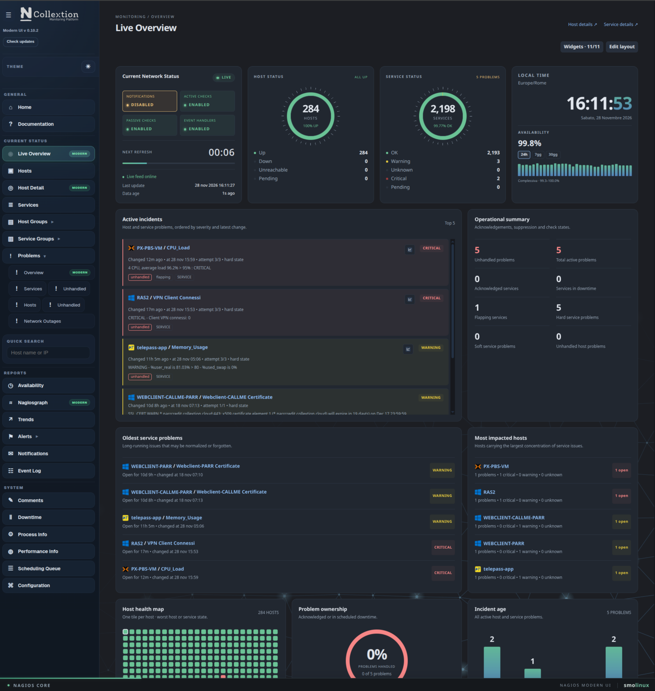
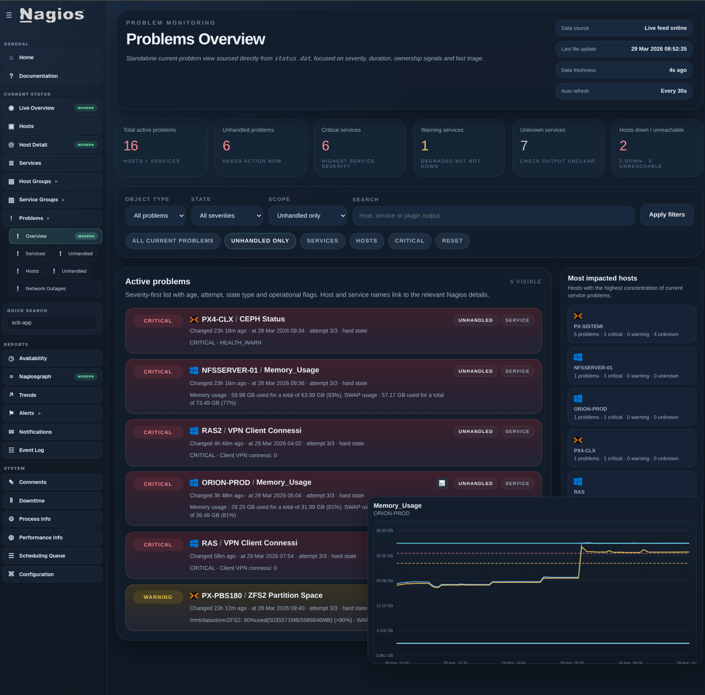
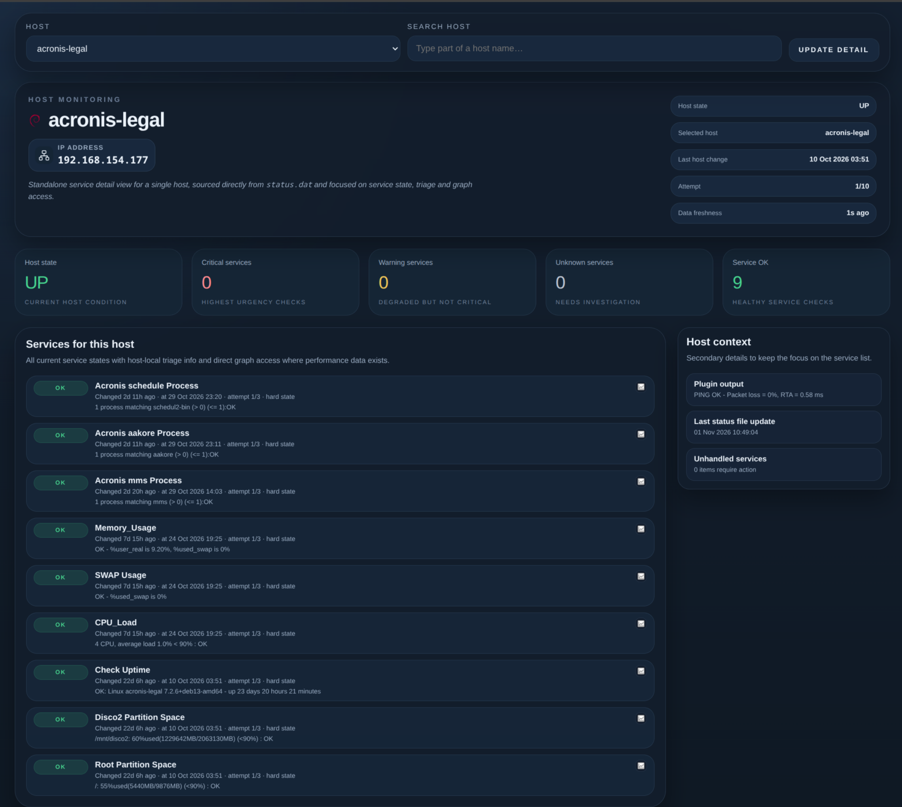
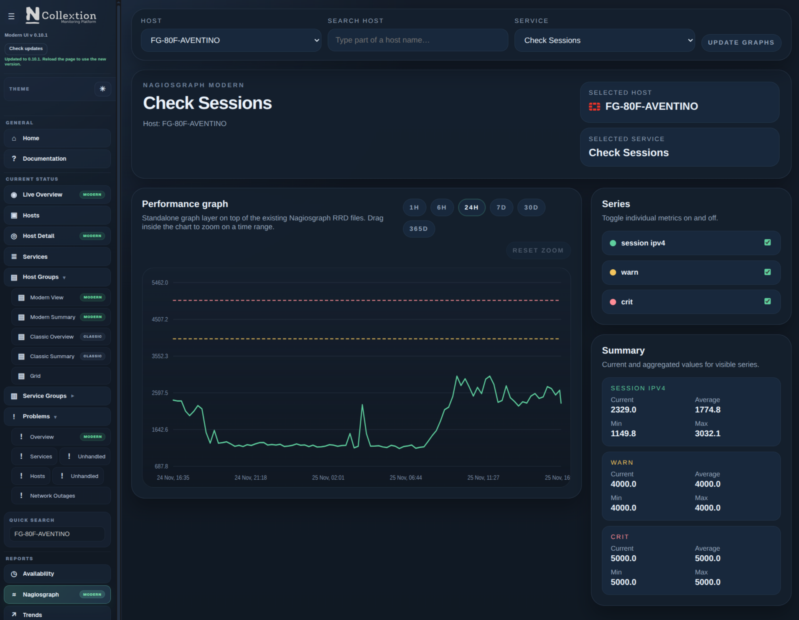
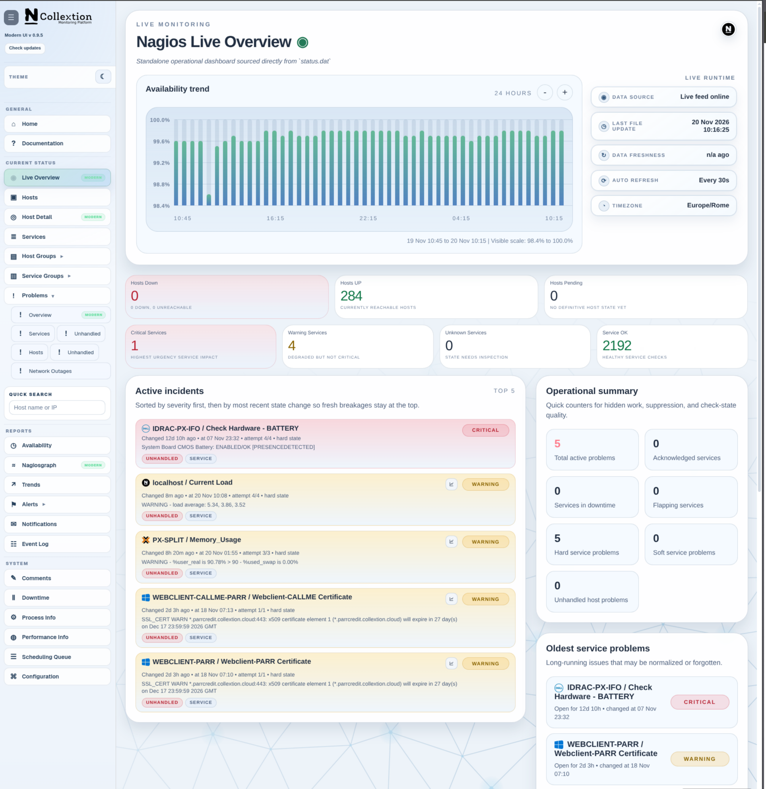
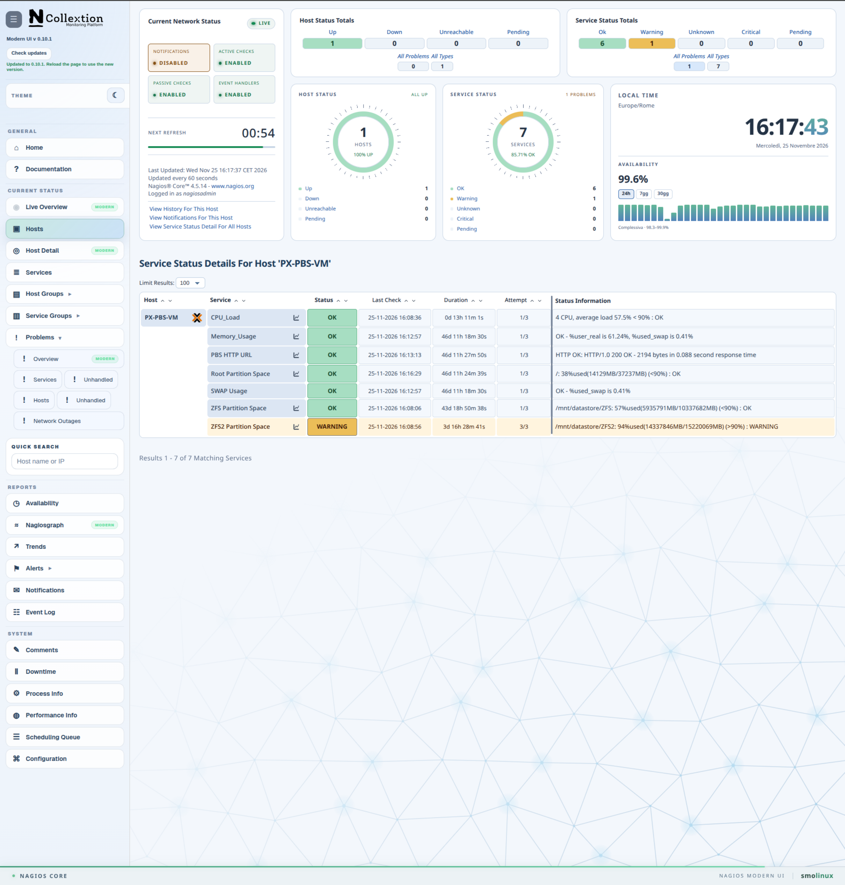
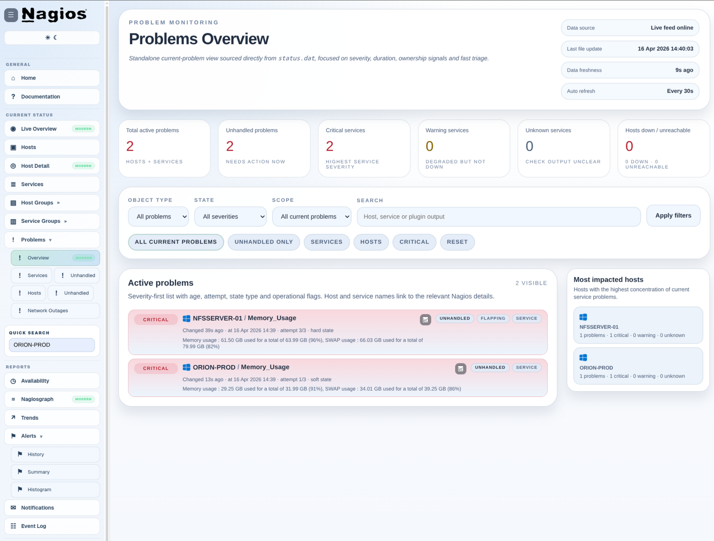
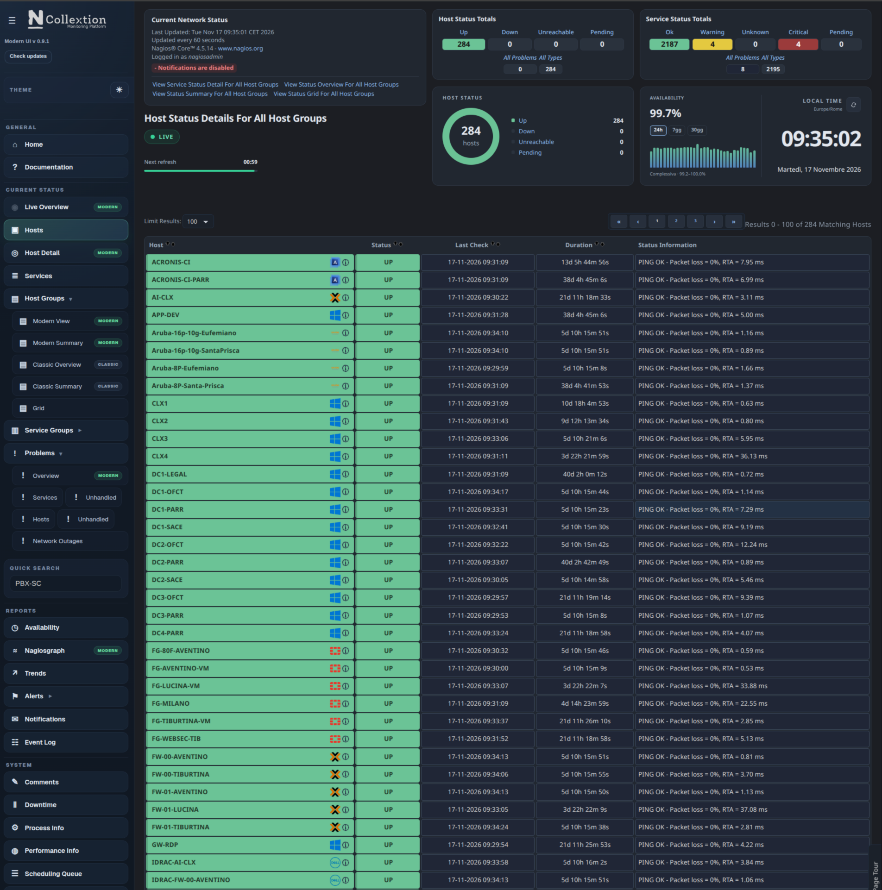
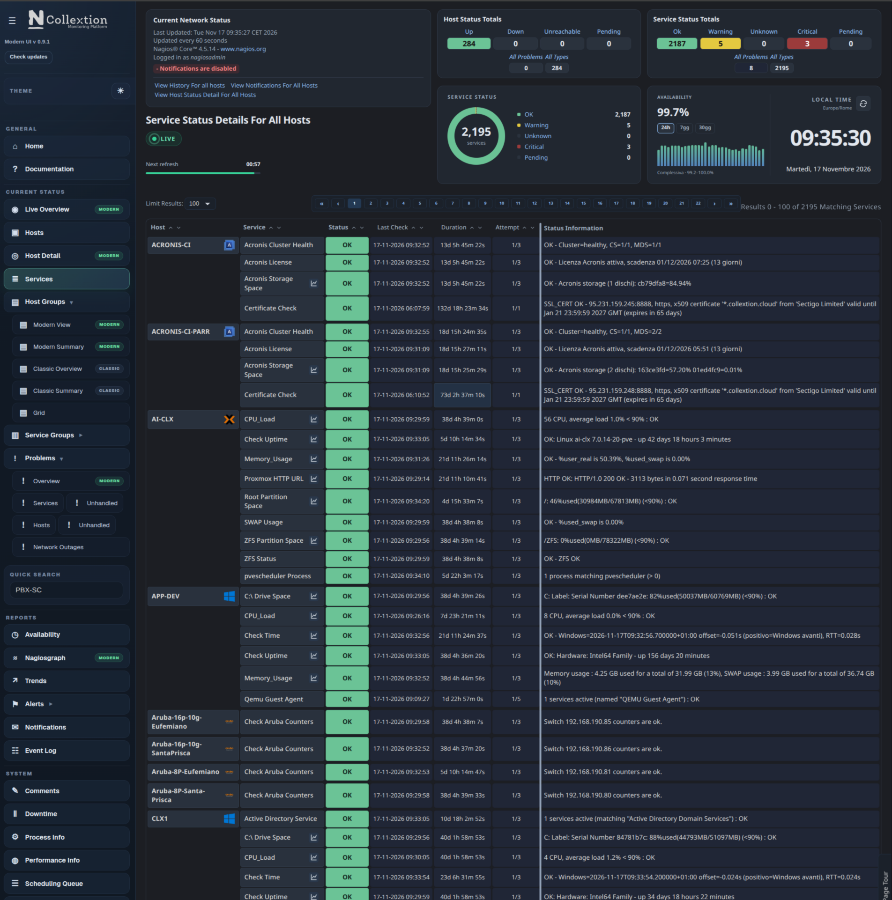

# Nagios Core Modern UI
A modern Nagios Core frontend refresh built with CSS, PHP and light JavaScript.

This project keeps the original Nagios CGI backend intact while adding standalone modern pages, a redesigned sidebar shell, a custom live dashboard and a modern graph layer backed by the same Nagiosgraph RRD files.

## Features

- Compact classic CGI layout with consistent typography, panels, tables and spacing across all 14 stylesheets
- Dark blue UI refresh across the standard Nagios Core pages
- Global dark/light theme switch with persisted preference
- Host and service status dashboards with linked donut charts, a local clock and a refresh-aware LIVE indicator
- Compact global availability trend with 24-hour, 7-day and 30-day selectors, using the same snapshot as Live Overview
- Digital clock, plus a native-refresh countdown beneath LIVE
- Gradient-colored digital seconds matching the availability trend and a static neural-network background fading from the lower-right corner
- Theme-aware transparent interface icons and animated flapping arrows in SVG and legacy GIF formats
- Responsive `index.php` shell and a modernized `side.php`
- Compact/expanded sidebar navigation with active page highlighting
- `live.php` modern live overview sourced directly from `status.dat`
- `problems.php` modern problems view with severity-first triage and host autocomplete in the search filter
- `host_detail.php` modern host service detail view with partial-name host autocomplete, keyboard navigation and a prominent configured host address below the host name
- `hostgroups.php` modern host group overview
- `hostgroups_summary.php` modern host group summary
- `nagiosgraph_modern/` modern graph frontend for existing Nagiosgraph RRD data, with host autocomplete in `show.php`
- Copy icons for the host name and address on classic Host Information pages inside Modern UI, with a temporary green checkmark after copying
- Host logo support via `hostextinfo.cfg`
- Historical availability snapshots via `live_trend_snapshot.php`
- Hover graph preview for graphed services through `popup.js`
- Light-theme coverage extended to modern pages and classic CGI pages (`status`, `avail`, `trends`, `history`, `summary`, `histogram`, `notifications`, `showlog`, `extinfo`, `config`, `cmd`)

## Included Modern Pages

- `live.php`
- `problems.php`
- `host_detail.php`
- `hostgroups.php`
- `hostgroups_summary.php`
- `nagiosgraph_modern/show.php`

These pages are standalone and reversible. They do not modify Nagios CGI binaries.

## Responsive Shell

Starting from the responsive shell work and expanded further in `0.5.0`, the project includes:

- a custom `index.php`
- a modern `side.php`
- JavaScript for active-nav syncing, theme persistence/sync and graph popup preview

Desktop and mobile are both supported:

- Desktop: collapsible left sidebar with compact and expanded modes
- Mobile: overlay sidebar with backdrop
- Narrow layouts: iframe scaling for old fixed-width Nagios CGI pages

## Screenshots

| Live Overview | Problems Overview |
|---|---|
|  |  |

| Host Detail | Nagiosgraph |
|---|---|
|  |  |

| Light Live Overview | Light Host Detail |
|---|---|
|  |  |

| Light Problems Overview |  |
|---|---|
|  |  |

| Classic Status Restyle | Classic Service Status Restyle |
|---|---|
|  |  |

## Installation

Replace the relevant files in your Nagios Core installation.

Core shell and modern pages:

```text
[nagios_root_path]/share/index.php
[nagios_root_path]/share/side.php
[nagios_root_path]/share/live.php
[nagios_root_path]/share/live_trend_snapshot.php
[nagios_root_path]/share/problems.php
[nagios_root_path]/share/host_detail.php
[nagios_root_path]/share/hostgroups.php
[nagios_root_path]/share/hostgroups_summary.php
[nagios_root_path]/share/modern_ui_status.php
[nagios_root_path]/share/nagios.png
[nagios_root_path]/share/stylesheets/theme.js
[nagios_root_path]/share/stylesheets/host-copy.js
[nagios_root_path]/share/stylesheets/status-sort.js
```

Nagiosgraph Modern:

```text
[nagios_root_path]/share/nagiosgraph_modern/config.example.php
[nagios_root_path]/share/nagiosgraph_modern/data.php
[nagios_root_path]/share/nagiosgraph_modern/popup.js
[nagios_root_path]/share/nagiosgraph_modern/show.php
```

Stylesheets:

```text
[nagios_root_path]/share/stylesheets/common.css
[nagios_root_path]/share/stylesheets/avail.css
[nagios_root_path]/share/stylesheets/cmd.css
[nagios_root_path]/share/stylesheets/config.css
[nagios_root_path]/share/stylesheets/extinfo.css
[nagios_root_path]/share/stylesheets/histogram.css
[nagios_root_path]/share/stylesheets/history.css
[nagios_root_path]/share/stylesheets/notifications.css
[nagios_root_path]/share/stylesheets/outages.css
[nagios_root_path]/share/stylesheets/showlog.css
[nagios_root_path]/share/stylesheets/status.css
[nagios_root_path]/share/stylesheets/summary.css
[nagios_root_path]/share/stylesheets/tac.css
[nagios_root_path]/share/stylesheets/trends.css
```

Icons and logos:

```text
[nagios_root_path]/share/images/comment.svg
[nagios_root_path]/share/images/action.svg
[nagios_root_path]/share/images/downtime.svg
[nagios_root_path]/share/images/status2.svg
[nagios_root_path]/share/images/flapping.svg
[nagios_root_path]/share/images/*-dark.svg
[nagios_root_path]/share/images/*.gif
[nagios_root_path]/share/images/logos/*
```

The five interface icons use uniform strokes. Comment, downtime, flapping and
information icons have transparent backgrounds. The graph action icon is also
transparent in the light theme and keeps its background in the dark theme. Modern
PHP pages use SVG; matching GIF exports retain the original filenames and pixel
dimensions for classic Nagios CGI pages. Install both formats, including the
`*-dark` variants. The shared stylesheet selects dark icons automatically with
the dark theme and keeps the original icons for the light theme. Information icons
use the same dark, reinforced symbol in both themes; transparent status icons also
use dark strokes on yellow WARNING cells. To regenerate the
GIF exports (light and `*-dark` variants) from their SVG sources, run `bash scripts/render-icons.sh` with
`rsvg-convert` (librsvg), `magick` (ImageMagick) and Python 3 installed.
The flapping arrows move in opposite directions in both SVG and GIF variants;
the GIF frames are generated from the SVG animation samples (1.2-second loop).

## Live Overview Historical Trend

If you want the historical availability trend in `live.php`, add this cron job:

```cron
*/5 * * * * root /usr/bin/php /usr/local/nagios/share/live_trend_snapshot.php >/dev/null 2>&1
```

This populates the JSON snapshot data used by the live availability widget.

## Status cockpit

Classic host and service detail pages show a cockpit with host/service status
instruments, the existing availability history and digital clock, and an
operations panel containing the native LIVE indicator and refresh countdown.
Instrument totals and state links come from the original CGI tables, retaining
their filters and user visibility. Native navigation, warnings, sorting and
pagination remain available. Active CGI filters and their state links are preserved;
the Display Filters panel is hidden. The native notifications-disabled notice is removed
from all CGI pages displayed through Modern UI, including pages without a cockpit.
Other warnings remain visible.

The notifications, active checks, passive checks and event-handler indicators
read the `programstatus` block through the read-only `modern_ui_status.php`
endpoint once per page load. It uses `cgi.cfg` and its `main_config_file` to locate
the configured `status_file`, falling back to `../var/status.dat` when no status
path is specified. The web server must be able to read these files. The endpoint
requires an authenticated web user unless CGI authentication is explicitly
disabled, and returns only the six program switches needed by the panel.

Active/passive checks show **MIXED** when host and service switches differ;
hover over the indicator for both states. Unavailable or missing states remain
neutral (`—`) and cannot be clicked. Click an available indicator to open the
original Nagios command confirmation in a dialog. Active/passive checks first
let you choose host or service checks. Opening the dialog sends no command;
**Commit** in the native form submits it through `cmd.cgi`, retaining Nagios
permissions, CSRF protection and any configured command comment fields. Read-only
or unauthorized users receive the native Nagios denial.

After Nagios acknowledges submission, the cockpit rereads program status up to
15 times, waiting one second between responses, and updates the indicators only
when the new state is observed.
An acknowledgment means the command was queued, not that the new state is already
active. If confirmation is delayed, the interface reports that explicitly and
does not automatically resubmit. The CGI's existing refresh continues to control
page updates; the cockpit adds no reload timer.

The shell has a full-width footer with the Modern UI signature. Its thin green
line follows the same refresh countdown as the cockpit, without another timer or
automatic reload. Pages without that countdown retain the static footer. Both
frames reserve space above it, so it never covers the last rows or sidebar items.
The footer follows the selected dark/light theme and reduced-motion preference.

## Browser updates

Click **Check updates** in the sidebar. When a newer release is available, users
listed directly in `authorized_for_system_commands` in Nagios `cgi.cfg` (or an
authenticated user when that setting is `*`) can click **Update now** and confirm.
Users marked as read-only in `authorized_for_read_only` cannot install updates.
The server downloads the official release's `share.zip`, checks its SHA-256 digest,
and copies its files into the existing Nagios `share` directory.

Existing `modern-ui-config.php` and files named `config.php` are preserved. Missing
configuration files are installed from the package. Files absent from the release
are retained; changes made directly to distributed interface files are overwritten.
The updater does not rename or replace the entire `share` directory.

Browser installation requires PHP cURL and Zip, working PHP sessions, outbound
HTTPS access to GitHub, a writable temporary directory, and write access for the
web server user to `share` and the destination subdirectories. The interface
reports missing prerequisites or copy errors. It never runs `sudo` or changes
server permissions. Authorization through contact groups alone is not supported
by the updater; list the intended administrator usernames directly.

Each file is replaced with a complete copy, and the version file is updated last.
This is a file overlay, without a whole-installation rollback: if copying is
interrupted, check for updates and retry, or install `share.zip` manually. Keep a
backup of local customizations. Reload the page after a successful update.

Install the version introducing this feature manually once; subsequent releases
can then be installed from the browser.

## Modern UI Configuration

Edit `share/modern-ui-config.php` (installed as
`/usr/local/nagios/share/modern-ui-config.php`) to configure date and time display:

```php
<?php
return [
    'timezone' => '',
    'language' => '',
    'live_refresh_seconds' => 30,
];
```

| Timezone | Language | Result |
| --- | --- | --- |
| Empty | Empty | Browser timezone and browser language |
| Set | Empty | Configured timezone and its associated language |
| Empty | Set | Browser timezone and configured language |
| Set | Set | Configured timezone and configured language |

For example, `timezone => 'Europe/Rome'` and `language => 'it'` display Rome time
and Italian dates even on a US device. Use a valid IANA timezone and a language
tag such as `it`, `en-GB`, `de`, `fr`, or `es`.

When only a timezone is configured, `Europe/Rome` selects Italian,
`Europe/Vienna` and `Europe/Berlin` German, `Europe/Paris` French, and
`Europe/Madrid` Spanish. Other configured timezones use English.
Invalid timezone overrides fall back to the browser timezone, then UTC.
Invalid or unsupported language overrides use the automatic language rule;
English is the final language fallback.

These settings apply to the digital dashboard clock and all dates in
`live.php` (last file update, state changes, trend axis, range and tooltips).
Language affects dates only; interface labels are unchanged. Times keep the
24-hour format. PHP renders UTC/English fallback dates if JavaScript is unavailable.

`live_refresh_seconds` must be a positive integer; invalid values use 30 seconds.
Keep this configuration when updating the installation. The release version
remains separately managed in `share/modern_ui_version.txt`.

## Nagiosgraph Modern Integration

`nagiosgraph_modern` reads existing performance data. It does not collect performance data or create RRD files. For Nagiosgraph, `insert.pl` creates and updates the files using its map rules; see the [Nagiosgraph installation guide](https://github.com/JasonRivers/nagiosgraph/blob/master/INSTALL).

By default, the graph backend searches the standard Nagiosgraph RRD directories, including `/usr/local/nagiosgraph/var/rrd`. It expects files named `<host>/<service>___<metric>.rrd`. To select a different path or use PNP4Nagios, copy `share/nagiosgraph_modern/config.example.php` to `share/nagiosgraph_modern/config.php` and edit it. For example:

```php
<?php
return [
    'backend' => 'pnp4nagios',
    'rrd_root' => '/usr/local/pnp4nagios/var/perfdata',
    'rrdtool' => '',
    'status_file' => '/usr/local/nagios/var/status.dat',
];
```

Select `nagiosgraph` for Nagiosgraph data, or `pnp4nagios` for PNP's `RRDPATH`. A nonempty `rrd_root` must be a readable directory; an invalid configured path does not fall back to another directory. `rrdtool` may be left empty for automatic detection. The web server user needs read and directory traversal permissions for the data. PNP support also requires the PHP SimpleXML extension and the XML files next to the RRDs. It reads PNP's `SINGLE` and `MULTIPLE` storage layouts and uses the XML datasource labels; its custom graph templates and warning/critical ranges are not reproduced. The PNP host list comes from XML metadata and is not filtered by `status.dat`. Only service graphs are integrated here; PNP host performance data is not integrated as a Nagios host graph.

The package includes only `config.example.php`, so the separately created `config.php` is retained when the release files are copied over an installation. Keep a backup of this local configuration. The PNP reader has been tested with synthetic data and still needs validation against real installations.

If you want graphed services to use the new graph page and hover preview, update your `graphed-service` template:

```cfg
define service {
       name graphed-service
       action_url /nagios/nagiosgraph_modern/show.php?host=$HOSTNAME$&service=$SERVICEDESC$' target='main' onClick='parent.hideModernGraphPopup()' onMouseOver='parent.showModernGraphPopup(this,event)' onMouseMove='parent.moveModernGraphPopup(event,this)' onMouseOut='parent.hideModernGraphPopup()' rel='/nagios/nagiosgraph_modern/show.php?host=$HOSTNAME$&service=$SERVICEDESC$&range=24h&embed=1
       register 0
       notification_interval 1440
}
```

Make sure `index.php` loads:

```html
<script src="nagiosgraph_modern/popup.js"></script>
```

## Notes

- Tested on Nagios Core `4.5.x`
- Modifies CSS, images, PHP and JavaScript
- Theme preference is persisted in browser storage (`localStorage`)
- Includes optional Nagios configuration changes for `action_url`
- Includes optional cron configuration for live trend history
- Fully reversible by restoring the original files

## Credits

Original UI: Nagios Core  
Modernization and standalone pages: community-driven

### Contributors

- Stefano Molisso — project author and maintainer
- Claude Sonnet / Claude Code (Anthropic) — AI-assisted development
- Codex (OpenAI) — AI-assisted development, classic CGI layout refinement and release preparation

PRs welcome.
